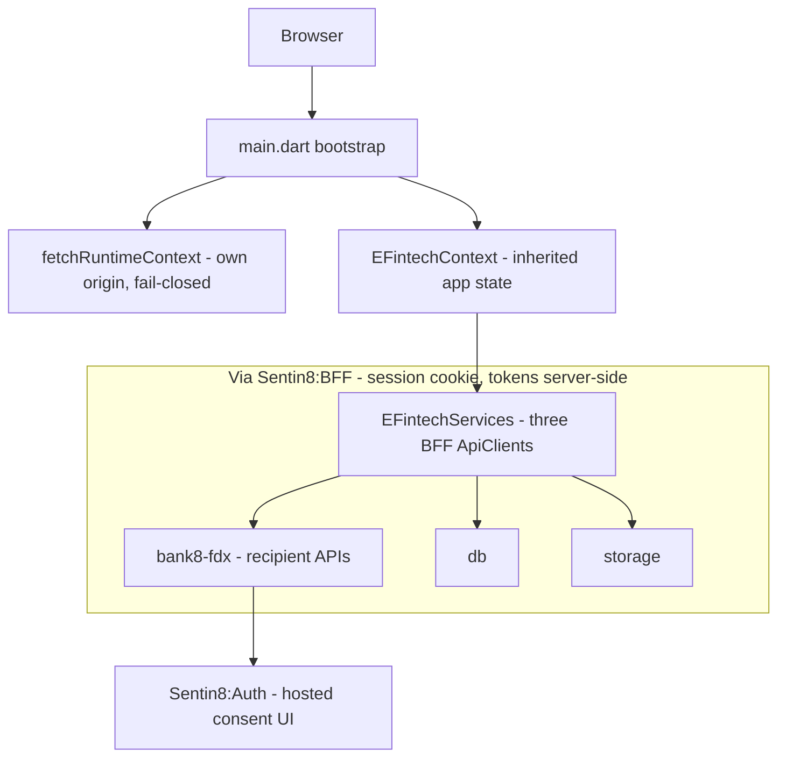

# Bank8:eFintech - FDX Data Recipient App

> Third-party Sentin8:App application. It uses the Sentin8 Flutter SDK
> (`sdk/flutter/sentin8`) as a published package. For wire-level detail read
> `DESIGN.md`; for the business view read `BUSINESS.md`.

## 1. Summary

eFintech is the FDX **Data Recipient** demo app of the Bank8 vertical: it
catalogs external FDX data providers, initiates consent flows, tracks consent
status, and displays consented account and transaction data retrieved through
Bank8:FDX. It also carries a small staff admin surface (instance overview,
FDX recipient-side administration). All backend access rides the
Sentin8:BFF proxy - tokens never reach the client.

## 2. Motivation

Open banking has two sides; eBank demonstrates the provider side, so the
recipient side needs its own app: a fintech that **retrieves** financial data
from external providers under customer consent. The recipient flow exercises
the hardest open-banking UX - provider discovery, consent hand-off to the
hosted authorization UI, polling until the consent resolves, and
consent-scoped data display - all through the platform's BFF/consent
machinery rather than bespoke integrations.

## 3. Architecture & High-Level Design

Components:

- **Bootstrap** - `fetchRuntimeContext()` (SDK) from the app's own origin;
  failure is fatal (`BootstrapError`), never degraded.
- **`EFintechContext`** (`app_context.dart`) - single `ChangeNotifier` state
  holder (runtime context + auth + services).
- **`EFintechServices`** (`services.dart`) - three BFF proxy clients: `fdx`,
  `db`, `storage` - the smallest registry of the four apps (a recipient
  needs no ledger/payments/post access).
- **`fdx_hooks.dart`** - recipient-side `DataState<T>` adapters: providers,
  consents (start/revoke/refresh), accounts (consent-filtered), transactions.
- **Shell + routing** (`efintech_shell.dart`) - hash routing + sidebar with a
  delegation-aware route guard.
- **Admin surface** (`pages/admin/`) - instance overview + FDX
  recipient-side administration.

## 4. Key Traits and Data Structures

- **`EFintechServices`**: the three-client registry (`fdx`, `db`, `storage`).
- **Recipient FDX hooks**: provider catalog, consent lifecycle
  (start → poll → active/failed/timeout), consent-scoped accounts and
  transactions.
- **Consent-start shape**: `POST /v1/recipient/consents/start` with customer,
  provider, requested FDX scopes, and `app_redirect_uri`; the response's
  authorization URL is consumed via `location.replace` (the consent UI is
  hosted by Sentin8:Auth).
- **Branding via `AppRuntimeContext`**: same fallback chain and theme
  application as the other apps.

## 5. Rationale, Trade-offs, and Alternatives

- **Polling over push for consent status.** The consent resolves on the
  provider side after the customer authorizes in the hosted UI; polling the
  recipient consents endpoint (2s interval, bounded attempts) is simple,
  stateless, and robust to page reloads. Rejected: a server-push channel for
  one transient consent journey (over-engineering at this stage).
- **`location.replace` for the consent redirect.** The hosted consent UI
  returns the customer through the app's redirect URI; replacing the current
  history entry avoids the app being trapped in a consent loop via the back
  button. Rejected: `location.assign` (back-button trap).
- **Smallest viable service registry.** The recipient never touches ledger
  directly - all retrieved data comes back through FDX recipient APIs
  (consent-checked upstream). Rejected: adding ledger/payments clients
  "for convenience" (would bypass the consent gate).
- **Fail-closed bootstrap.** Same posture as the other apps: without a
  verified instance identity, no page loads.

## 6. Internal Implementation & Invariants (Private Design)

- **Routing is hash-based inside the shell** (`/`, `/providers`,
  `/providers/{id}`, `/consents`, `/accounts`, `/admin`, `/admin/fdx`);
  `url_router.dart` only re-exports SDK navigation helpers.
- **Consent polling is bounded** (2s × 30 attempts) and terminal states
  (`ACTIVE` / `FAILED` / `TIMEOUT`) stop the loop; an expired poll is a
  surfaced error, not a silent wait.
- **Accounts and transactions are always consent-scoped**: the list accepts
  an optional `consentId` filter, and detail/transaction pages inherit the
  consent context from navigation. The app never displays data outside a
  consenting relationship.
- **Invariants:**
  - No direct external provider calls - all FDX traffic goes through
    Bank8:FDX recipient APIs via the BFF (CI guard enforces).
  - No OAuth token in the client; the BFF attaches tokens server-side.
  - No page builds a service URL itself (runtime context + client path
    composition only).

## 7. Unresolved Questions / Future Designs
- Payment initiation as FDX data recipient (money movement write through the
  provider) is out of scope today - the app is data-read only.
- Aggregate refresh scheduling (background re-sync of consented accounts) is
  a platform/job concern not yet exposed to apps.

---

**Architecture & Design:** bank8:efintech and its underlying concepts were designed by [Hamid Jahanzad](https://www.linkedin.com/in/hamidjahanzad/).
